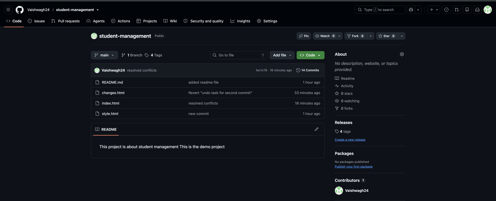

This project is about student management
This is the demo project 

***********************************
Installation or setup steps:
1.Clone the project 
2.Open the file in the web

**********************************
Git command used: 
1.git clone
2.git add
3.git commit
4.git push origin 

**********************************
History of commands:

1164  2026-10-28 09:25  ssh -i /Users/vaishnavi/Desktop/virginia-key-pair.pem ec2-user@3.94.160.59
 1165  2026-10-28 09:26  cd ..
 1166  2026-10-28 09:26  cd ..
 1167  2026-10-28 09:26  mkdir student_management
 1168  2026-10-28 09:26  cd student_management
 1169  2026-10-28 09:27  nano index.html
 1170  2026-10-28 09:28  nano style.html
 1171  2026-10-28 09:28  git init
 1172  2026-10-28 09:29  git branch
 1173  2026-10-28 09:29  git statius
 1174  2026-10-28 09:29  git status
 1175  2026-10-28 09:29  git add .
 1176  2026-10-28 09:29  git commit -m "new commit"
 1177  2026-10-28 09:31  git branch -M main
 1178  2026-10-28 09:31  git remote add origin https://github.com/Vaishwagh24/student-management.git
 1179  2026-10-28 09:31  git push -u origin main
 1180  2026-10-28 09:33  ls
 1181  2026-10-28 09:34  nano README.md
 1182  2026-10-28 09:35  git status
 1183  2026-10-28 09:35  git add .
 1184  2026-10-28 09:35  git commit -m "added readme file"
 1185  2026-10-28 09:35  git push origin maoin
 1186  2026-10-28 09:35  git push origin main
 1187  2026-10-28 09:36  cd ..
 1188  2026-10-28 09:36  cd DEVOPS-SELF
 1189  2026-10-28 09:36  ls
 1190  2026-10-28 09:36  git clone https://github.com/Vaishwagh24/student-management.git
 1191  2026-10-28 09:36  ls
 1192  2026-10-28 09:37  git branch
 1193  2026-10-28 09:37  cd student-management
 1194  2026-10-28 09:37  git branch
 1195  2026-10-28 09:37  git checkout -b feature/login
 1196  2026-10-28 09:37  git branch
 1197  2026-10-28 09:39  nano index.html
 1198  2026-10-28 09:40  git status
 1199  2026-10-28 09:40  git add .
 1200  2026-10-28 09:40  git commit -m "new changes in index form"
 1201  2026-10-28 09:40  git checkout main
 1202  2026-10-28 09:41  git merge feature/login
 1203  2026-10-28 09:41  git status
 1204  2026-10-28 09:41  git status
 1205  2026-10-28 09:41  git push origin main
 1206  2026-10-28 09:41  nano index.html
 1207  2026-10-28 09:42  git checkout -b feature/dashboard
 1208  2026-10-28 09:42  nano index.html
 1209  2026-10-28 09:45  git status
 1210  2026-10-28 09:45  git add .
 1211  2026-10-28 09:45  git stash
 1212  2026-10-28 09:46  git branch
 1213  2026-10-28 09:46  git checkout feature/login
 1214  2026-10-28 09:46  nano index.html
 1215  2026-10-28 09:47  git status
 1216  2026-10-28 09:47  git checkout feature/dashboard
 1217  2026-10-28 09:48  nano index.html
 1218  2026-10-28 09:48  git stash pop
 1219  2026-10-28 09:48  nano index.html
 1220  2026-10-28 09:49  git stash pop
 1221  2026-10-28 09:50  git add .
 1222  2026-10-28 09:50  git commit -m "login branch update"
 1223  2026-10-28 09:50  git stash pop
 1224  2026-10-28 09:50  nano index.html
 1225  2026-10-28 09:53  git branch
 1226  2026-10-28 09:53  nano changes.html
 1227  2026-10-28 09:54  git add .
 1228  2026-10-28 09:54  git commit -m "undo"
 1229  2026-10-28 09:55  rm changes.html
 1230  2026-10-28 09:55  ls
 1231  2026-10-28 09:56  git add .
 1232  2026-10-28 09:56  git commit -m "sdf"
 1233  2026-10-28 09:56  nano changes.html
 1234  2026-10-28 09:56  git add .
 1235  2026-10-28 09:57  git status
 1236  2026-10-28 09:57  git restore --staged changes.html
 1237  2026-10-28 09:57  git status
 1238  2026-10-28 09:58  git add .
 1239  2026-10-28 09:58  git commit -m "undo task"
 1240  2026-10-28 10:00  nano changes.html
 1241  2026-10-28 10:00  git add .
 1242  2026-10-28 10:00  git commit -m "undo task for second commit"
 1243  2026-10-28 10:01  git log --oneline
 1244  2026-10-28 10:01  git revert HEAD
 1245  2026-10-28 10:01  git log --oneline
 1246  2026-10-28 10:02  nano changes.html
 1247  2026-10-28 10:06  git tag 1.0
 1248  2026-10-28 10:06  git log -oneline
 1249  2026-10-28 10:06  git log --oneline
 1250  2026-10-28 10:07  git tag v1.0
 1251  2026-10-28 10:08  git tag -a v1.0 -m "anotated tag"
 1252  2026-10-28 10:08  git tag -a v1.1 -m "anotated tag"
 1253  2026-10-28 10:08  git tag show
 1254  2026-10-28 10:08  git tag 
 1255  2026-10-28 10:08  `git push origin --tags\n;\n'\n`
 1256  2026-10-28 10:09  git push origin --tags`\n`
 1257  2026-10-28 10:09  git branch
 1258  2026-10-28 10:09  git statis
 1259  2026-10-28 10:10  git status
 1260  2026-10-28 10:10  nano index.html
 1261  2026-10-28 10:10  git checkout feature/login
 1262  2026-10-28 10:10  nano index.html
 1263  2026-10-28 10:11  git add .
 1264  2026-10-28 10:12  git commit -m "changes for conflict"
 1265  2026-10-28 10:12  git checkout feature/dashboard
 1266  2026-10-28 10:12  git add .
 1267  2026-10-28 10:12  git status
 1268  2026-10-28 10:12  git commit -m "conflict"
 1269  2026-10-28 10:12  git merge feature/login
 1270  2026-10-28 10:13  nano index.html
 1271  2026-10-28 10:13  git status
 1272  2026-10-28 10:13  nano index.html
 1273  2026-10-28 10:13  git add .
 1274  2026-10-28 10:13  git commit -m "changes for conflict"
 1275  2026-10-28 10:14  git checkout feature/login
 1276  2026-10-28 10:14  nano index.html
 1277  2026-10-28 10:14  git add .
 1278  2026-10-28 10:14  git commit -m "conflict"
 1279  2026-10-28 10:14  git merge feature/dashboard
 1280  2026-10-28 10:15  nano index.html
 1281  2026-10-28 10:15  git status
 1282  2026-10-28 10:15  git add .
 1283  2026-10-28 10:15  git commit -m "resolved conflicts"
 1284  2026-10-28 10:16  git chekout main
 1285  2026-10-28 10:16  git checkout main
 1286  2026-10-28 10:16  git merge feature/login
 1287  2026-10-28 10:16  git push origin main
 1288  2026-10-28 10:16  git checkout feature/login
 1289  2026-10-28 10:24  nano .gitignore
 1290  2026-10-28 10:25  nano test.log
 1291  2026-10-28 10:25  gi status
 1292  2026-10-28 10:25  git status
 1293  2026-10-28 10:26  nano README.md
 1294  2026-10-28 10:30  git history
 1295  2026-10-28 10:30  history
 1296  2026-10-28 10:31  history

**************************************
Screenshot of repo:

 
